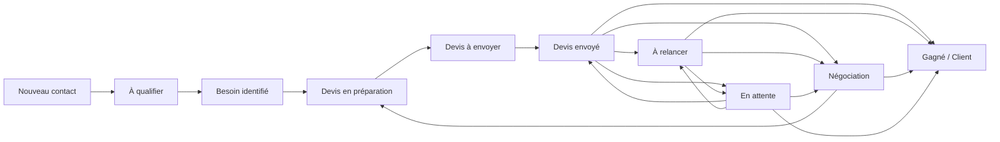
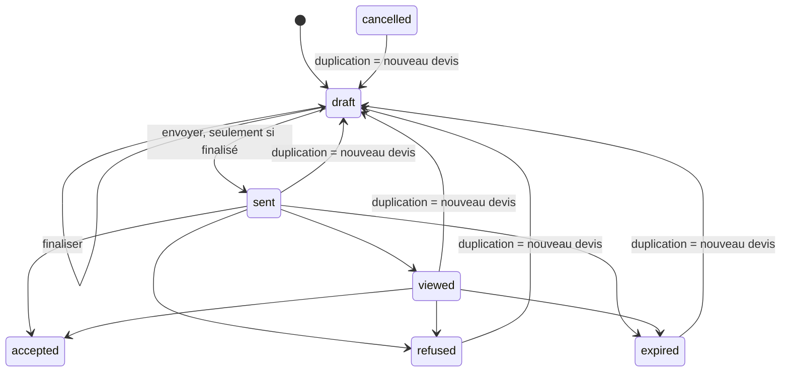

# AtoumWeb Manager — Modèle consolidé des workflows CRM

> Branche de référence : `fix/recette-commerciale-coherence`.
>
> Ce document décrit le comportement attendu et désormais appliqué sur le périmètre **Prospect / Devis / Client**. Les matrices détaillées restent dans `CRM_TRANSITION_MATRIX.md`. Les statuts Projet / Intervention / Maintenance sont volontairement documentés comme chantier suivant et ne sont pas déclarés stabilisés ici.

## Sources de vérité

- Société : `organizations`.
- Personne : `contacts`.
- Coordonnées multiples : `contact_methods`, avec fallback sur les anciennes colonnes email/téléphone uniquement pour compatibilité.
- Besoins : `crm_needs`.
- Actions et relances : `crm_actions`.
- Prospect : `prospects`.
- Devis : `quotes` + `quote_lines` avec snapshots catalogue.
- Client : `client_accounts` + `client_contact_roles`.
- Historique CRM : `activity_events`.
- Recherche : `search_documents`, reconstruisible.

## Parcours commercial de référence

Le parcours ne doit pas être court-circuité par un changement manuel de statut lorsqu’une action métier dédiée existe.

## Prospect

États :

`new`, `qualifying`, `need_identified`, `quote_to_prepare`, `quote_to_send`, `quote_sent`, `follow_up`, `negotiation`, `waiting`, `won`, `lost`.

La couche service protège désormais les transitions manuelles principales. Le sélecteur et le glisser-déposer ne doivent pas permettre de remplacer une action métier comme créer, finaliser, envoyer ou accepter un devis.

Transitions manuelles admises :

- `new → qualifying | lost`
- `qualifying → new | need_identified | lost`
- `need_identified → qualifying | lost`
- `quote_to_prepare → lost`
- `quote_to_send → lost`
- `quote_sent → follow_up | negotiation | waiting | lost`
- `follow_up → quote_sent | negotiation | waiting | lost`
- `negotiation → follow_up | waiting | lost`
- `waiting → quote_sent | follow_up | negotiation | lost`
- `won` est terminal dans le pipeline.
- `lost → new | qualifying` permet une réactivation commerciale explicite.

### Qualification

Le passage automatique `qualifying → need_identified` exige cinq éléments :

1. résumé du projet ;
2. décideur renseigné ; si la réponse est « Non », le décideur réel doit être précisé ;
3. budget cohérent ou explicitement non communiqué ;
4. calendrier cohérent ou explicitement non communiqué ;
5. au moins un besoin persistant dans `crm_needs`.

La qualification peut être enregistrée incomplète sans changer le statut.

### Rappel versus relance

Une action commerciale simple sur un contact précoce reste une `action` et ne change pas le pipeline.

Une `follow_up` n’entraîne automatiquement `follow_up` que lorsque le Prospect se trouve déjà dans un contexte devis : `quote_sent`, `follow_up`, `negotiation` ou `waiting`.

## Devis

États techniques : `draft`, `sent`, `viewed`, `accepted`, `refused`, `expired`, `cancelled`.

`finalized_at` est une propriété distincte : un devis finalisé reste `draft` mais devient « prêt à envoyer ».

Règles stabilisées :

- `finalize()` est idempotent ; un deuxième appel ne réécrit pas la date.
- `markSent()` refuse un brouillon non finalisé.
- les lignes et conditions d’un devis envoyé ne sont plus modifiables ; la négociation passe par duplication.
- `accept()` est idempotent et convertit/rattache le Prospect au Client sans doublon.
- l’ancien devis reste figé lorsqu’un nouveau devis de négociation est créé.

### Trace d’envoi

`quotes.sent_at` conserve la date d’envoi. Canal, destinataire et note sont conservés dans une `crm_action` terminée liée au devis. En V1, cette action constitue la preuve structurée d’envoi et la fiche Prospect sait relire ces informations.

## Actions et relances

`crm_actions` gère :

- type `action` ou `follow_up` ;
- échéance ;
- notes ;
- canal de réalisation ;
- résultat ;
- compte rendu ;
- prochaine action ;
- récurrence `none|weekly|monthly|quarterly|yearly`.

La complétion répétée est sans effet supplémentaire et une récurrence crée la prochaine occurrence tout en conservant l’occurrence terminée.

## Client

Le Client représente la relation commerciale et contractuelle ; les éléments de production restent dans Projet.

La conversion Prospect → Client est idempotente :

1. si le Prospect a déjà un `client_account_id`, il est réutilisé ;
2. sinon un Client existant de la même organisation est recherché ;
3. à défaut, un Client correspondant au contact principal est recherché ;
4. sinon un nouveau Client est créé ;
5. le Prospect passe à `won` et est lié au Client.

Les coordonnées visibles et la recherche Client utilisent désormais `contact_methods` en priorité, avec fallback legacy.

## Éléments encore hors stabilisation commerciale

Le modèle ci-dessus ne déclare pas terminées les machines d’états suivantes :

- Projet ;
- Intervention ;
- Maintenance.

Le parcours cible reste documenté dans `CRM_TRANSITION_MATRIX.md`, mais son enforcement côté services est réservé à la passe Projet/Opérations afin de ne pas mélanger la recette commerciale avec ce chantier.