# AtoumWeb Manager — Modèle des workflows

> **Référence analysée** : branche documentaire créée depuis `fix/recette-commerciale-prospects` au commit `be9d086bd4b284269eabeb7b0199b275cbda59a7`.
>
> Ce document décrit le **code réellement présent** à ce point de référence. Codex effectue en parallèle une validation locale de la branche fonctionnelle ; si un nouveau commit est poussé, un contrôle de delta est requis avant de déclarer cette documentation définitive.

## Principes de source de vérité

- **Identité société** : `organizations`.
- **Personnes** : `contacts`.
- **Coordonnées multiples** : `contact_methods`. Les colonnes historiques `organizations.email/phone` et `contacts.email/phone` restent des valeurs de compatibilité/repli.
- **Besoins structurés** : `crm_needs`. `prospects.primary_need` reste un champ historique/de repli ; l’affichage Prospect calcule le besoin courant depuis `crm_needs`.
- **Actions / relances** : `crm_actions`. `prospects.next_action_*` et `client_accounts.next_action_*` sont des caches de compatibilité synchronisés par `ActionService`.
- **Devis contractuel** : `quotes` + `quote_lines`; les lignes issues du catalogue conservent un `snapshot_json`.
- **Production** : `projects`, `project_nodes`, `project_services`, `project_prerequisites`.
- **Temps** : `time_sessions` + `time_session_pauses` ; durée et synthèses sont calculées.
- **Maintenance / packs d’heures** : tables dédiées ; leurs soldes/consommations sont calculés à partir des mouvements/sessions.
- **Historique CRM** : `activity_events`. Les modules opérations/projets/temps utilisent aussi `activity_log` : il existe donc deux journaux techniques à distinguer.

## Diagramme entité-relation métier

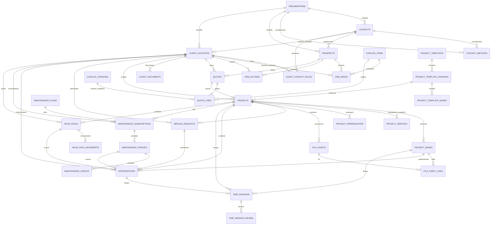

## 1. Prospect

États : `new`, `qualifying`, `need_identified`, `quote_to_prepare`, `quote_to_send`, `quote_sent`, `follow_up`, `negotiation`, `waiting`, `won`, `lost`.

Le service vérifie qu’un besoin persistant existe pour toute destination autre que `new`, `qualifying` ou `lost`, mais **n’impose pas de matrice d’adjacence** : tout état valide peut techniquement être demandé par `changeProspectStage`. Le passage `lost` exige une raison.

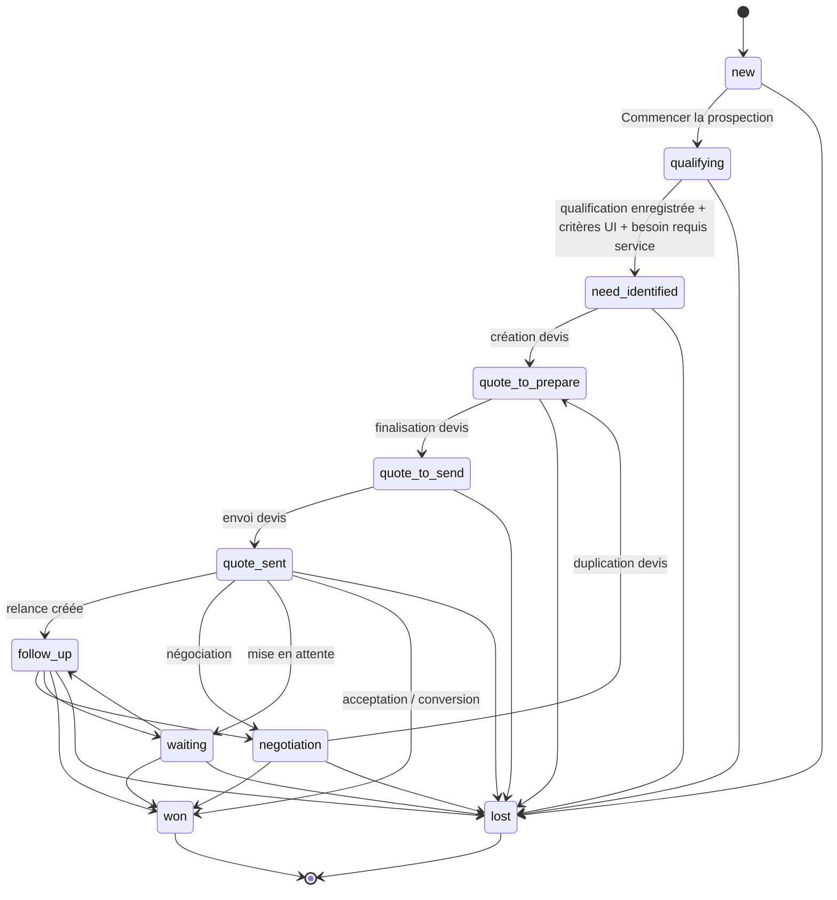

**Important** : les flèches ci-dessus sont le parcours métier recommandé. Le service actuel permet davantage de sauts manuels que ce diagramme.

## 2. Devis

États SQLite : `draft`, `sent`, `viewed`, `accepted`, `refused`, `expired`, `cancelled`.

`finalized_at` est **orthogonal** au statut : un devis finalisé reste `draft`, ce qui matérialise correctement la distinction « prêt à envoyer » / « envoyé ».

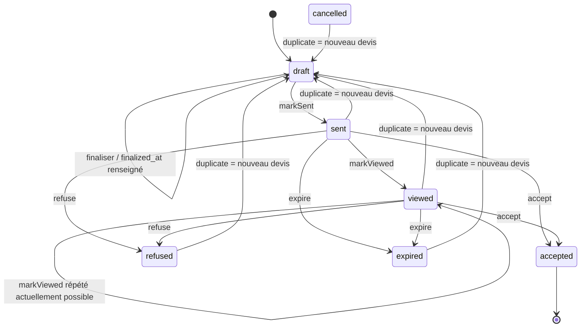

- Les lignes d’un devis non `draft` sont protégées par le service d’édition.
- `accept()` est idempotent si le devis est déjà accepté.
- `finalize()` n’est pas strictement idempotent : un deuxième appel réécrit `finalized_at` et recrée un événement.

## 3. Client

États : `active`, `inactive`, `archived`.

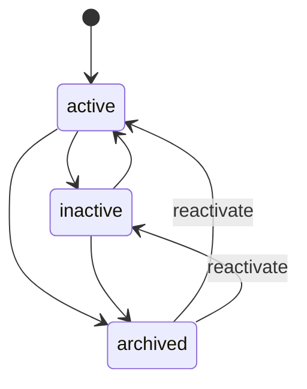

L’archivage est logique : il ne supprime ni le client ni les documents physiques. La réactivation conserve le même identifiant et le même dossier.

## 4. Projet

États : `to_prepare`, `in_progress`, `waiting_client`, `blocked`, `to_validate`, `completed`, `archived`.

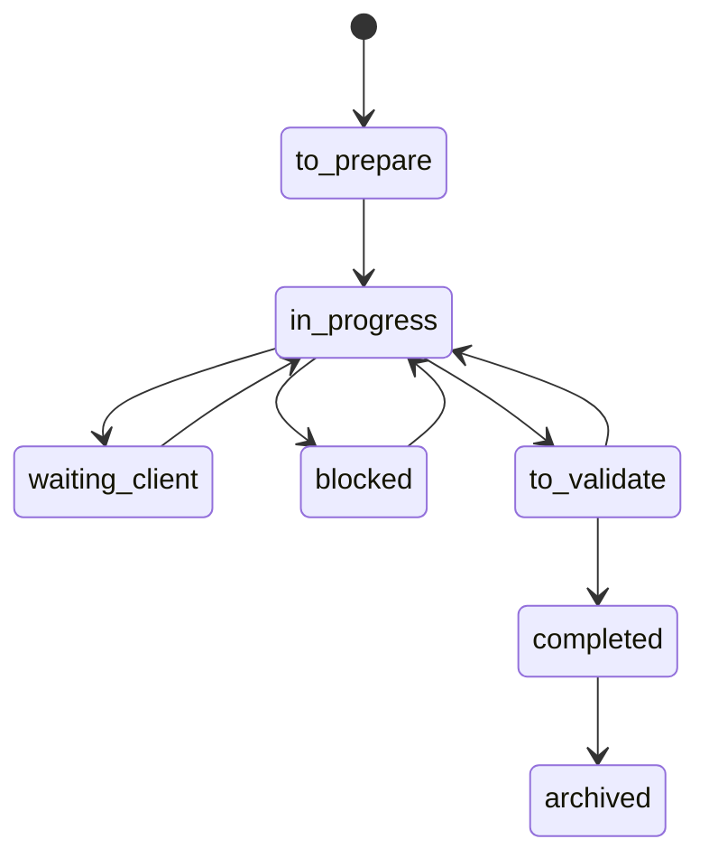

**Écart actuel** : `changeProjectStatus()` accepte n’importe quel statut valide depuis n’importe quel autre statut. Les flèches ci-dessus sont la machine métier recommandée, pas une contrainte actuellement imposée par le service.

## 5. Demande

États : `new`, `to_qualify`, `waiting_client`, `planned`, `converted`, `closed`, `archived`.

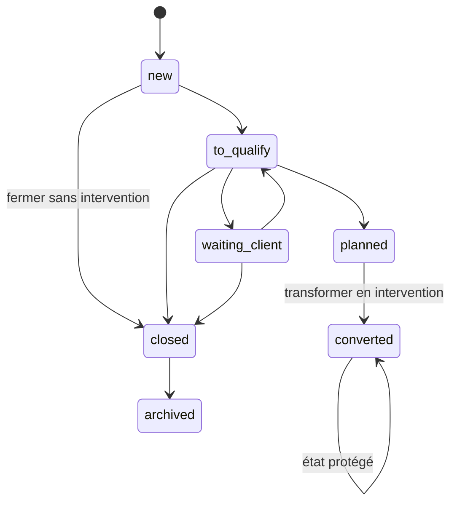

Une demande `converted` ne peut plus être repassée à un autre statut par le service. La transformation est idempotente grâce à l’unicité de `interventions.source_request_id` et à une recherche préalable.

## 6. Intervention

États : `to_plan`, `planned`, `in_progress`, `waiting_client`, `blocked`, `to_validate`, `completed`, `cancelled`, `archived`.

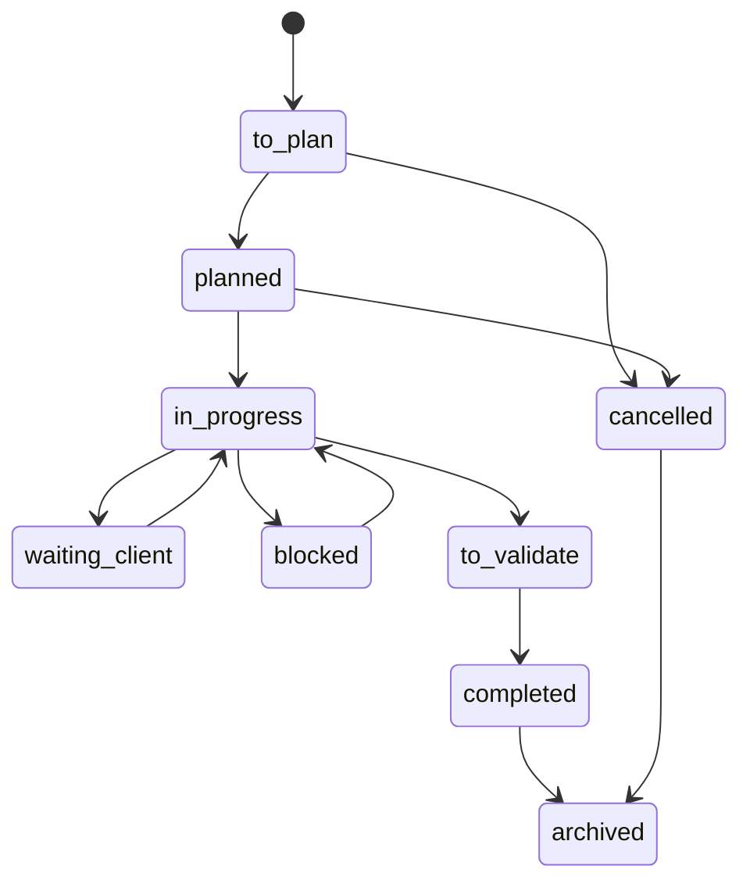

**Écart actuel** : comme pour Projet, `changeInterventionStatus()` valide la valeur mais pas le chemin. Passer hors `completed` efface `completed_at`; repasser hors `archived` efface `archived_at`.

## 7. Maintenance

### Souscription

États : `active`, `suspended`, `ended`, `archived`.

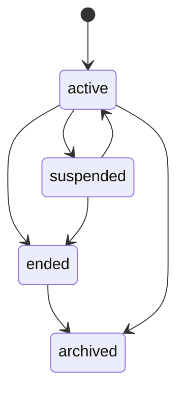

Le service ne contraint pas actuellement l’adjacence ; toute valeur valide peut être appliquée.

### Période

États : `upcoming`, `open`, `to_do`, `in_progress`, `completed`, `closed`.

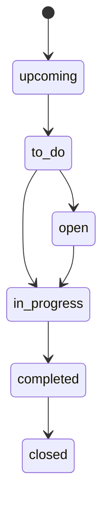

`ensurePeriod()` est idempotent sur `(subscription_id, period_start, period_end)`.

## 8. Pack d’heures

États : `active`, `exhausted`, `expired`, `suspended`, `archived`.

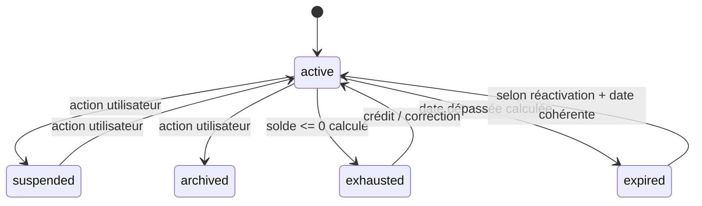

`exhausted` et `expired` sont calculés et ne peuvent pas être choisis manuellement. Le débit d’une intervention est idempotent via `source_key`; l’annulation d’un mouvement est idempotente via `reversal_of_movement_id`.

## 9. Timer / session de temps

Le Timer n’a pas une colonne de statut : son état découle de `ended_at` et de l’existence d’une pause ouverte.

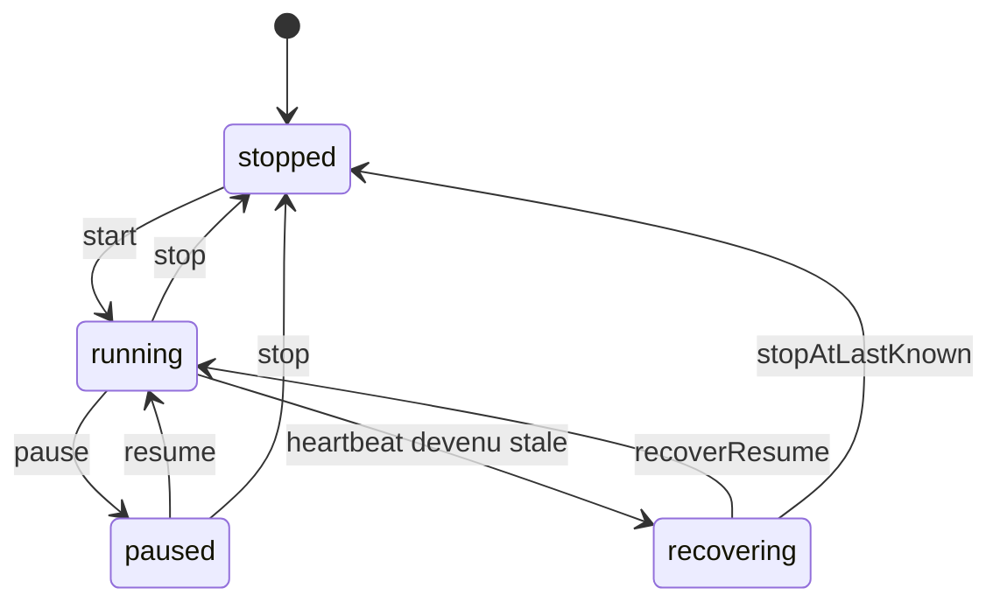

Invariants techniques : une seule `time_session` active globalement via index partiel ; une seule pause ouverte par session ; `pause`, `resume` et `stop` ont des comportements idempotents partiels.

# Parcours commercial transversal

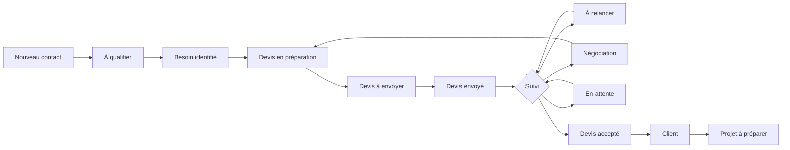

## Séquence 1 — création du devis depuis Prospect

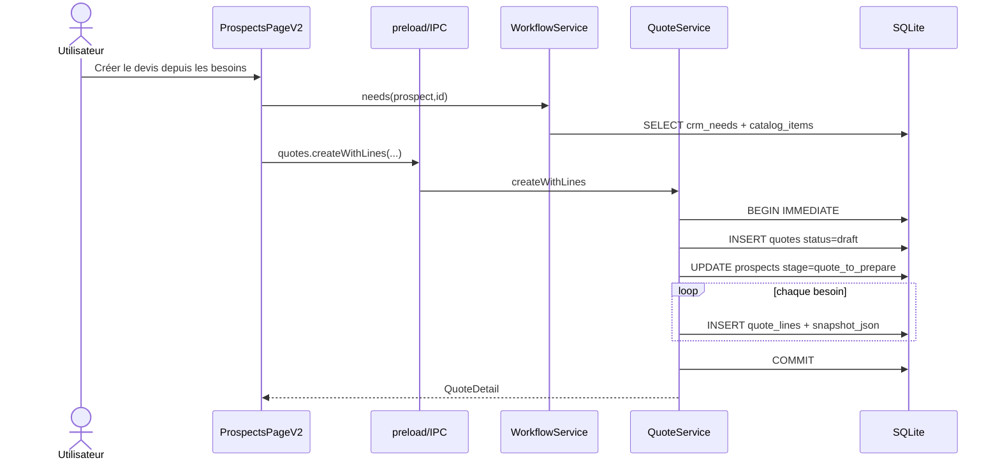

## Séquence 2 — finalisation puis envoi

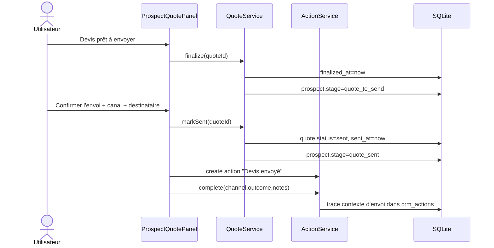

## Séquence 3 — relance

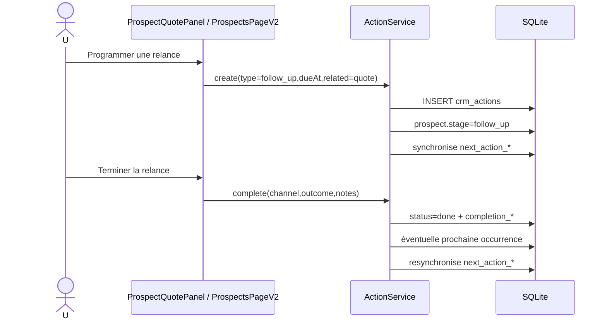

## Séquence 4 — négociation / duplication

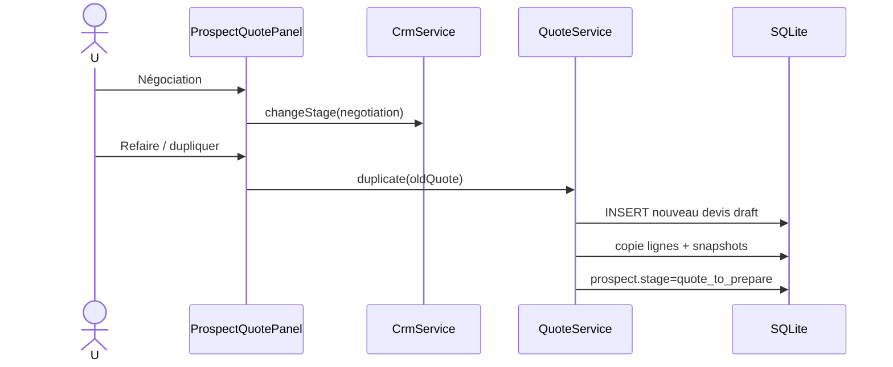

## Séquence 5 — acceptation

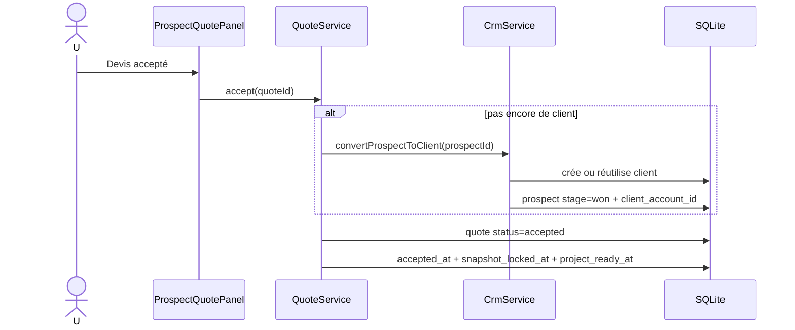

## Séquence 6 — conversion idempotente Prospect → Client

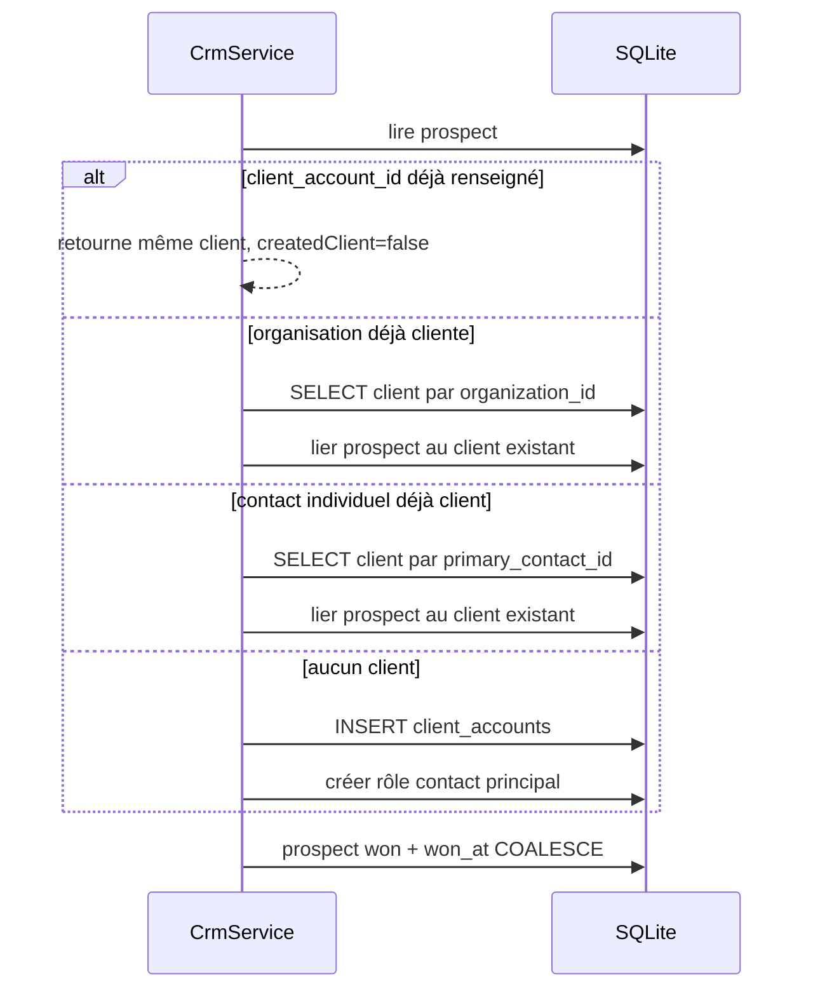

## Séquence 7 — création Projet depuis devis accepté

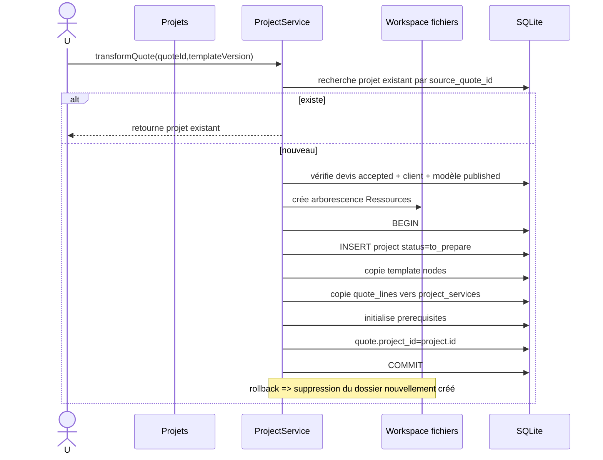

## Séquence 8 — archivage Client et documents

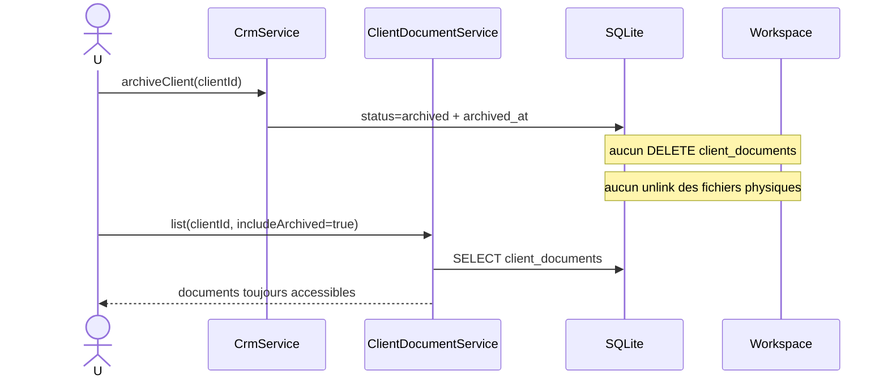

# Recommandations de cohérence

1. **Formaliser les matrices de transitions dans les services**, pas seulement dans l’UI, pour Prospect, Projet, Intervention, Maintenance et souscriptions.
2. **Rendre `finalize()` idempotent** ou refuser proprement une deuxième finalisation sans réécrire la date.
3. **Inclure le besoin dans le calcul UI de qualification** : aujourd’hui l’UI affiche 4/4 sans vérifier `crm_needs`, alors que le service refuse `need_identified` sans besoin.
4. **Conserver `contact_methods` comme source de vérité des coordonnées** et traiter les colonnes email/téléphone historiques uniquement comme compatibilité ; les vues Client doivent progressivement lire la nouvelle source.
5. **Garder la distinction finale : Prospect = cockpit commercial, Devis = édition détaillée, Client = relation durable, Projet = production.**
6. **Ne pas automatiser une suppression RGPD** : l’échéance doit déclencher une revue, jamais un effacement silencieux.
7. **Unifier ou documenter explicitement les deux journaux** (`activity_events` CRM vs `activity_log` opérations/projets) pour éviter une timeline incomplète selon l’écran.
