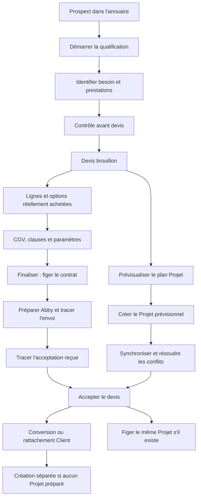
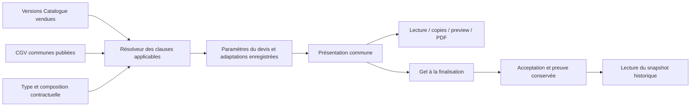
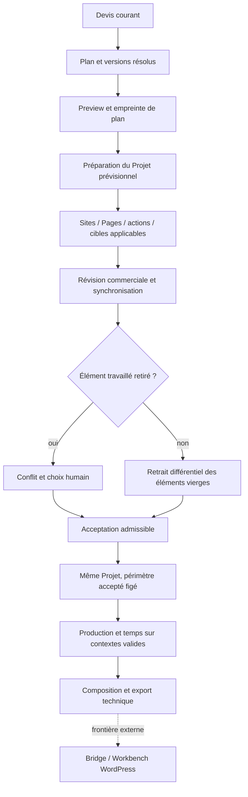
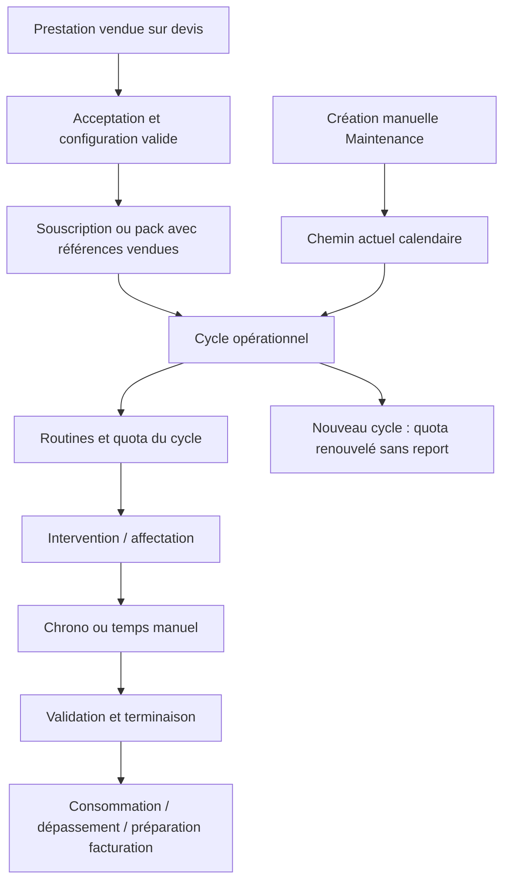
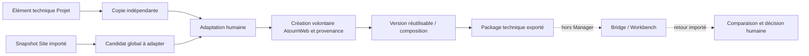

# 04 — Parcours utilisateurs et transitions

Référence : **eb252d5cbd0e95137eafa2b4759fcbcfd7263eda**. Schémas des chemins examinés, pas garantie de tous les cas conditionnels.

## Parcours commercial

- Ajouter à l’annuaire crée un Prospect new ; il ne démarre pas seul le parcours.
- Enregistrer la qualification et valider l’étape sont distincts. Le passage incomplet confirmé existe dans le code et doit être formalisé, pas supposé normatif pour tout module.
- Les prestations seulement disponibles ne contribuent pas. Une option devient vendue par sa ligne persistée.
- Un devis finalisé reste techniquement draft, mais ses lignes/conditions sont protégées.
- Envoi enregistré et signature/acceptation externe restent distincts ; Abby est manuel.
- La preuve d’acceptation du nouveau parcours est vérifiée côté service. Une simple confirmation de clic n’est pas présentée comme validation juridique globale.

Sources : [createWithLines / finalize / markSent / accept](https://github.com/atoumweb-prog/atoumweb-manager/blob/eb252d5cbd0e95137eafa2b4759fcbcfd7263eda/src/main/commercial/QuoteService.ts) ; [transitions et conversion](https://github.com/atoumweb-prog/atoumweb-manager/blob/eb252d5cbd0e95137eafa2b4759fcbcfd7263eda/src/main/crm/CrmService.ts). Tests : [Devis](https://github.com/atoumweb-prog/atoumweb-manager/blob/eb252d5cbd0e95137eafa2b4759fcbcfd7263eda/src/main/commercial/QuoteService.test.ts), [CRM](https://github.com/atoumweb-prog/atoumweb-manager/blob/eb252d5cbd0e95137eafa2b4759fcbcfd7263eda/src/main/crm/CrmService.test.ts).

## Parcours contractuel

Le type organise la composition ; il ne déclenche pas une clause d’option non vendue. Les textes restent dans la bibliothèque de clauses existante. Un type versionne sa composition, les clauses ont leur propre versionnement, et le devis conserve le contenu exact dans son snapshot.

Les contrôles techniques ne constituent pas un avis juridique. Les paramètres connus peuvent être repris des versions vendues ; qualification, droits, dates et tarifs inconnus ne doivent pas être inventés.

Le contrat fait partie du devis. Après gel/acceptation, les nouvelles éditions de la bibliothèque ne réécrivent pas le snapshot. L’absence historique reste conservée.

Sources : [résolution / presentation / freezeQuote](https://github.com/atoumweb-prog/atoumweb-manager/blob/eb252d5cbd0e95137eafa2b4759fcbcfd7263eda/src/main/commercial/ContractTermsService.ts), [types et liens](https://github.com/atoumweb-prog/atoumweb-manager/blob/eb252d5cbd0e95137eafa2b4759fcbcfd7263eda/src/main/commercial/ContractTypeService.ts), [restitution commune](https://github.com/atoumweb-prog/atoumweb-manager/blob/eb252d5cbd0e95137eafa2b4759fcbcfd7263eda/src/shared/contractPresentation.ts). Tests : [Clauses](https://github.com/atoumweb-prog/atoumweb-manager/blob/eb252d5cbd0e95137eafa2b4759fcbcfd7263eda/src/main/commercial/ContractTermsService.test.ts), [Types](https://github.com/atoumweb-prog/atoumweb-manager/blob/eb252d5cbd0e95137eafa2b4759fcbcfd7263eda/src/main/commercial/ContractTypeService.test.ts), [Paramètres et preuves](https://github.com/atoumweb-prog/atoumweb-manager/blob/eb252d5cbd0e95137eafa2b4759fcbcfd7263eda/src/main/commercial/QuoteContractPreparationService.test.ts).

## Projet, structures et affectations

- Une preview périmée peut être refusée au moment de préparer ; elle ne doit pas être appliquée silencieusement.
- Révision du même dossier et duplication indépendante sont deux actions.
- Synchronisation autorisée sur le Projet prévisionnel ; historique et travail conservés lors des conflits.
- Les cibles et capacités exigées sont vérifiées ; D peut garder une destination pending selon sa politique. Une cible manuelle/historique n’acquiert pas implicitement les capacités d’un modèle.
- Le gel du périmètre commercial n’est pas le statut de production in_progress. L’activation n’est pas déclarée comme paiement reçu ou démarrage automatique.
- Les prérequis sont consultables ; aucune preuve de paiement ne doit être inventée. Toutes les anciennes matrices de statut Projet ne sont pas réputées automatiquement appliquées.
- Les actions et estimations internes restent distinctes des durées contractuelles ; leurs ajustements n’effacent pas la provenance de référence.

Sources : [prepare / sync / accept / resolveConflict](https://github.com/atoumweb-prog/atoumweb-manager/blob/eb252d5cbd0e95137eafa2b4759fcbcfd7263eda/src/main/projects/ProjectCommercialService.ts), [cibles](https://github.com/atoumweb-prog/atoumweb-manager/blob/eb252d5cbd0e95137eafa2b4759fcbcfd7263eda/src/main/projects/ProjectContributionTargetService.ts), [statuts et production](https://github.com/atoumweb-prog/atoumweb-manager/blob/eb252d5cbd0e95137eafa2b4759fcbcfd7263eda/src/main/projects/ProjectService.ts). Tests : [Projet commercial](https://github.com/atoumweb-prog/atoumweb-manager/blob/eb252d5cbd0e95137eafa2b4759fcbcfd7263eda/src/main/projects/ProjectCommercialService.test.ts), [Cibles](https://github.com/atoumweb-prog/atoumweb-manager/blob/eb252d5cbd0e95137eafa2b4759fcbcfd7263eda/src/main/projects/ProjectContributionTargets.test.ts), [Opérationnel](https://github.com/atoumweb-prog/atoumweb-manager/blob/eb252d5cbd0e95137eafa2b4759fcbcfd7263eda/src/main/projects/ProjectOperationalService.test.ts).

## Maintenance, interventions et temps

Le chemin de vente nouveau applique les cycles date à date. Facturation annuelle et cycles mensuels sont distincts. Les actions vendues restent associées aux références acceptées ; historique calendaire non migré silencieusement. La divergence manuelle est UX-02, pas une correction appliquée.

La terminaison sur pack doit traiter un temps terminé. UX-03 constate un état intermédiaire après refus ; le solde n’a pas été débité dans l’expérience. Les mouvements de pack ont des traces et des inversions motivées, pas une suppression silencieuse.

Sources : [provision](https://github.com/atoumweb-prog/atoumweb-manager/blob/eb252d5cbd0e95137eafa2b4759fcbcfd7263eda/src/main/operations/OperationalSalesService.ts), [periodBounds / ensurePeriod](https://github.com/atoumweb-prog/atoumweb-manager/blob/eb252d5cbd0e95137eafa2b4759fcbcfd7263eda/src/main/operations/MaintenanceService.ts), [complete](https://github.com/atoumweb-prog/atoumweb-manager/blob/eb252d5cbd0e95137eafa2b4759fcbcfd7263eda/src/main/operations/InterventionCompletionService.ts), [débits](https://github.com/atoumweb-prog/atoumweb-manager/blob/eb252d5cbd0e95137eafa2b4759fcbcfd7263eda/src/main/operations/HourPackService.ts), [chrono](https://github.com/atoumweb-prog/atoumweb-manager/blob/eb252d5cbd0e95137eafa2b4759fcbcfd7263eda/src/main/time/TimeService.ts). Tests : ventes/maintenance/complétion/packs/temps, détaillés dans [08](08-TESTS-ET-COUVERTURE.md).

## Réutilisation et retours Bridge

Les deux origines ne sont pas identiques : Projet prépare d’abord une copie indépendante avant création volontaire ; Bridge peut créer explicitement un candidat global à adapter, dont l’original est conservé. Une création de candidat n’est pas une validation réutilisable ni une publication sur le site client.

Les packages/imports/retours sont présents dans le Manager. Le scénario réel jusqu’à publication WordPress nécessite une recette du plugin externe. Le manifeste exige un passage Workbench et n’annonce pas d’injection directe en production.

Sources : [copie et promotion](https://github.com/atoumweb-prog/atoumweb-manager/blob/eb252d5cbd0e95137eafa2b4759fcbcfd7263eda/src/main/referentials/ReusePreparationService.ts), [createLibraryCandidate](https://github.com/atoumweb-prog/atoumweb-manager/blob/eb252d5cbd0e95137eafa2b4759fcbcfd7263eda/src/renderer/bridge/BridgeSitesPage.tsx), [package / workbenchRequired](https://github.com/atoumweb-prog/atoumweb-manager/blob/eb252d5cbd0e95137eafa2b4759fcbcfd7263eda/src/main/referentials/AtoumWebPackageService.ts), [retours](https://github.com/atoumweb-prog/atoumweb-manager/blob/eb252d5cbd0e95137eafa2b4759fcbcfd7263eda/src/main/referentials/AtoumWebOccurrenceReturnService.ts).

## Annulation, retour et reprise

| Contexte | Comportement identifié | Limite |
|---|---|---|
| Brouillon éditable | Sauvegarde/modification ; abandon local possible | UX-01 : protection de saisie inégale |
| Devis finalisé/envoyé | Révision ou duplication selon dossier ; contenu ancien conservé | Ne pas défiger un historique par mise à jour de bibliothèque |
| Projet prévisionnel | Synchronisation et choix de conflit ; éléments travaillés conservés | Décisions par élément et contexte |
| Production Projet | Undo/redo de certaines modifications locales dans la session | Pas un undo global de toutes les opérations |
| Pack | Inversion motivée d’un mouvement | Consommation et historique ne doivent pas être écrasés |
| Document | Archivage/restauration ; suppression définitive confirmée | Preuve contractuelle liée protégée ; politique de conservation globale à arbitrer |
| Chrono | Pause/reprise/récupération et correction encadrée | Le temps réel doit rester cohérent avec contexte et historique |
| Workspace | Changement enregistré, redémarrage requis | Restauration différée et workspace cible : UX-16 |

Ces schémas décrivent les chemins examinés et leurs frontières. Ils ne créent aucune autorisation de développement ou d’activation.
